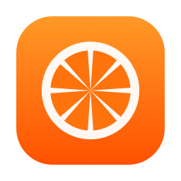
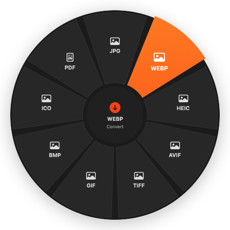

<p align="center">
  
</p>

<h1 align="center">Tangelo</h1>

<p align="center">
  <b>Convert, edit and move files right where you drag them.</b><br>
  A free, open-source macOS menu-bar utility with 45+ formats, 30+ tools and floating file shelves.
</p>

<p align="center">
  <a href="https://github.com/thisisrishi/Tangelo/releases/latest"></a>
  
  
  <a href="LICENSE"></a>
</p>

<p align="center">
  
</p>

---

## Why Tangelo

Start dragging any file, tap a modifier key, and a wheel opens under your cursor. Drop on a
petal and the work is done: a HEIC becomes a JPG, a video becomes a GIF, a PDF gets split, a
screenshot gets a gradient frame. The result appears next to the original, and the original is never touched.

- **Works where you already are**: Finder, Desktop, any app you can drag files out of.
- **Private**: everything runs locally. No accounts, analytics, ads or network calls.
- **Native**: built on AVFoundation, Core Image, PDFKit and Vision. A 2 MB universal app.

## Install

**Homebrew**

```sh
brew install --cask thisisrishi/tap/tangelo
```

**Download**: grab `Tangelo.dmg` from the [latest release](https://github.com/thisisrishi/Tangelo/releases/latest),
open it, and drag Tangelo into Applications.

> **First launch:** Tangelo isn't notarized by Apple yet, so macOS shows *"Apple could not verify Tangelo…"*.
> Open **System Settings → Privacy & Security** and click **Open Anyway**, or run
> `xattr -dr com.apple.quarantine /Applications/Tangelo.app`. The Homebrew command above handles this for you.

**Optional helpers** unlock extra formats:

```sh
brew install ffmpeg   # MP3, OGG, Opus, WMA, MKV, WebM, AVI, WMV
brew install webp     # WebP encoding
```

Pages, Numbers and Keynote (free on the App Store) enable iWork and PowerPoint conversions.
LibreOffice enables legacy `.xls`.

## Quick start

1. Find the Tangelo icon in your menu bar.
2. Start dragging files in Finder.
3. While dragging, **tap** a modifier key:

| Tap | Opens | What's inside |
|---|---|---|
| **⇧ Shift** | Conversion wheel | Every format the dragged files can become |
| **⌘ Command** | Tools wheel | Tools that fit the dragged files |
| **⌃ Control** | Actions wheel | AirDrop, Float, Copy to…, Move to…, Copy Path, Terminal, Quick Look, Reveal |

4. Drop on a petal. Drop in the center, or move away, to cancel.

**Shake** the cursor while dragging to drop files into a new **Float**, a floating shelf that holds
files until you need them.

No drag handy? Drop files on the menu-bar popover, or click **Finder Selection** there.

See the full **[Usage Guide](docs/USAGE.md)** for every tool and setting.

## Features

### Conversions

| From | To |
|---|---|
| **Images**: JPG, PNG, HEIC, WebP, AVIF, TIFF, GIF, BMP, ICO, SVG | JPG · PNG · WebP · HEIC · AVIF · TIFF · GIF · BMP · ICO · PDF |
| **Video**: MP4, MOV, M4V, MKV, WebM, AVI, WMV | MP4 · MOV · M4V · MKV · WebM · AVI · GIF · MP3 · M4A · WAV |
| **Audio**: MP3, M4A/AAC, WAV, FLAC, AIFF, OGG, Opus, WMA | MP3 · M4A · WAV · FLAC · AIFF · OGG · Opus |
| **Documents**: DOCX, DOC, ODT, Pages, RTF, RTFD, TXT, Markdown, HTML, EPUB, Text Clippings | DOCX · PDF · RTF · TXT · Markdown · HTML · EPUB · ODT · RTFD · Pages |
| **PDF** | DOCX · TXT · Markdown · RTF · HTML · EPUB · PNG · JPG (OCR for scanned pages) |
| **Spreadsheets**: XLSX, XLS, ODS, Numbers, CSV, TSV, JSON | XLSX · CSV · TSV · JSON · HTML · Markdown · PDF |
| **Presentations**: PPTX, PPT, Keynote | PDF · PPTX · PNG |
| **Subtitles**: SRT, VTT | SRT · VTT · TXT |
| **Any files or folders** | ZIP · TAR · TAR.GZ |

### Tools

| Images | Video | Audio | PDF & files |
|---|---|---|---|
| Compress (preset / target size / %) | Trim | Trim (auto-trim silence) | Make PDF from images |
| Adjust (exposure, warmth, grain…) | Crop | Normalize loudness | Merge PDFs |
| Annotate (arrows, text, magnifier, steps) | Change speed 0.25×–4× | Mono / stereo & balance | Split PDF (pages or ranges) |
| Frame (gradient backgrounds) | Mute | Bleep / silence ranges | Organize pages (reorder, rotate, delete) |
| Crop (batch, ratios) | Join clips | Waveform visualizer video | Compress PDF |
| Resize | Split into clips | Compress | Extract ZIP, RAR, 7Z, TAR, GZ, XZ |
| Remove background | Snapshots (frames → PNG) | | Metadata: view, edit, strip |
| Copy text (OCR) | Redact (blur over time ranges) | | Batch rename |
| Redact (auto-detect faces & text) | Make GIF | | |
| Collage · Read QR codes | Compress (preset / target size) | | |

### Floats

Floating shelves for files in transit: thumbnails, multi-select, drag everything out at once,
Quick Look with <kbd>Space</kbd>, right-click to convert or run tools, collapse to a slim bar.
Floats survive relaunches.

### Everything else

- **History with Undo**: every operation is logged; Undo moves its outputs to the Trash.
- **Output location**: next to the original, Downloads, Desktop, or a custom folder.
- **Configurable** wheel shortcuts, conversion defaults (quality, bitrate, HEVC, GIF size), terminal app (Terminal, iTerm, Ghostty, Warp).
- Launch at login, sound and haptic feedback, onboarding.
- **Open With → Tangelo** from Finder drops files into a Float.

## Permissions

| Permission | Why | When asked |
|---|---|---|
| Automation → Finder | Read your Finder selection | First use of **Finder Selection** |
| Automation → Pages / Numbers / Keynote | iWork and PowerPoint conversions | First iWork conversion |
| Login Items | Launch at login | Onboarding (optional) |

Tangelo needs no Accessibility or Screen Recording access.

## Build from source

Requires macOS 14+ and Swift 5.10+ (Xcode or just the Command Line Tools).

```sh
git clone https://github.com/thisisrishi/Tangelo.git
cd Tangelo
./build.sh                 # → build/Tangelo.app, Tangelo.dmg, Tangelo.zip (universal)
open build/Tangelo.app
```

During development: `swift build && .build/debug/Tangelo`.

### Self-test

Tangelo ships with an end-to-end self-test that generates sample media and runs 70+ real
conversions and tool operations:

```sh
build/Tangelo.app/Contents/MacOS/Tangelo --selftest /tmp/tangelo-selftest
```

### Project layout

```
Sources/Tangelo/
├── App/        App entry, menu bar, settings, job runner, dispatcher, self-test
├── Core/       Engines: images, audio (PCM), video, documents, PDF, spreadsheets, subtitles, archives
├── Tools/      Tool catalog and operations (image, video, audio, metadata)
└── UI/
    ├── Wheel/  Global drag monitor and radial wheel
    ├── Float/  Floating file shelves and Quick Look
    └── Editors/ One SwiftUI editor per tool
```

## Limitations

- MP3/OGG/Opus/WMA encoding and MKV/WebM/AVI/WMV need `ffmpeg`; WebP encoding needs `cwebp`.
- DOCX export uses Apple's writer, which flattens tables and drops hyperlinks.
- iWork and PowerPoint conversions automate Pages/Numbers/Keynote, or use LibreOffice.

## Contributing

Bug reports, feature ideas and pull requests are welcome; see [CONTRIBUTING.md](CONTRIBUTING.md).

## License

[MIT](LICENSE) © 2026 Rishi Raj Jaiswal
